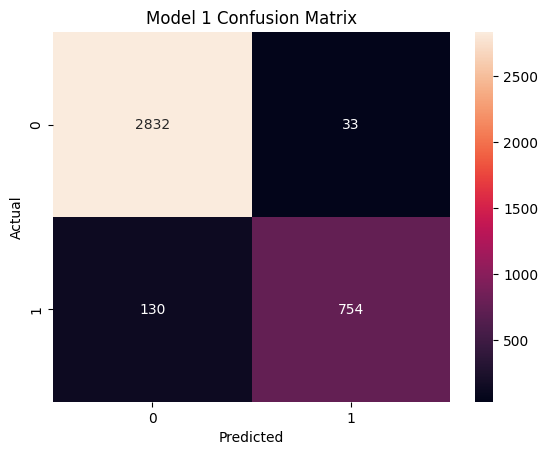
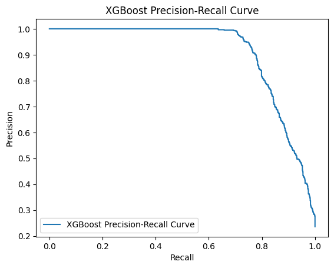
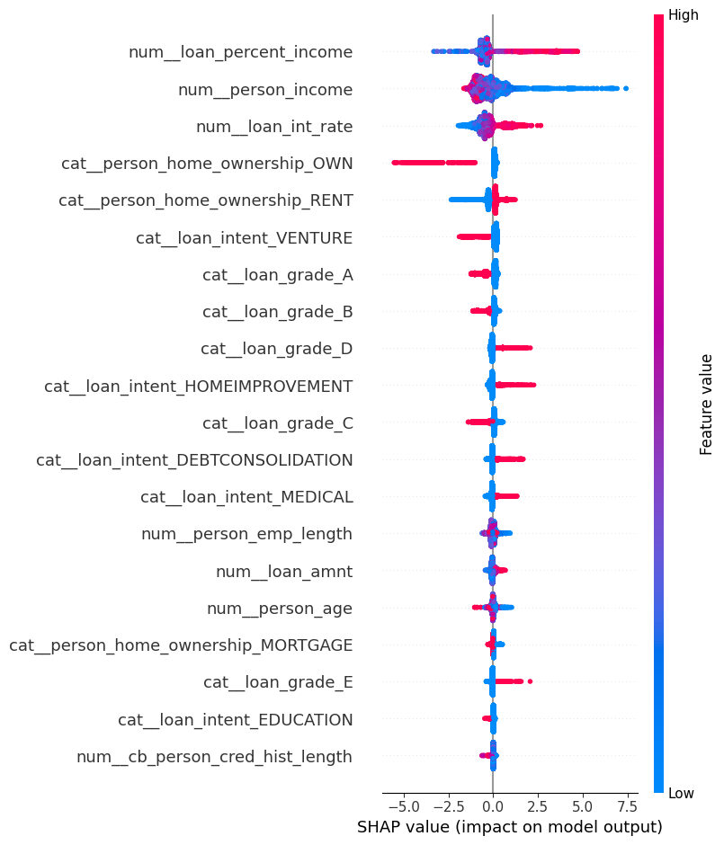
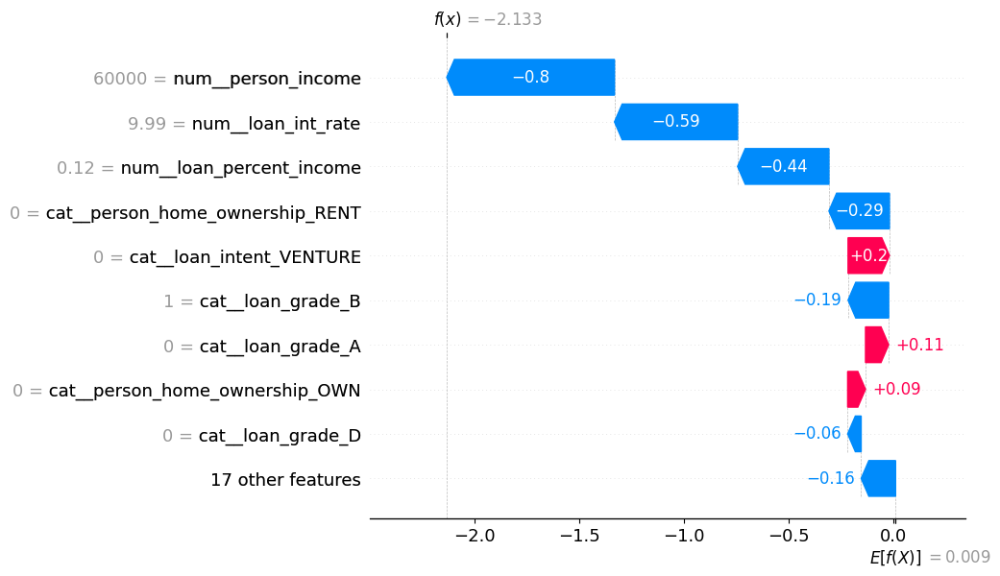

<div align="center">


<br/>

[](https://credit-risk-assesment-using-shap-3nc1.onrender.com)
[](https://www.python.org/)
[](https://fastapi.tiangolo.com/)
[](https://xgboost.readthedocs.io/)
[](https://scikit-learn.org/)
[](https://shap.readthedocs.io/)
[](https://render.com/)

### 🔍 Predict who might default on a loan — and understand *why*.

[**🌐 Live Demo**](https://credit-risk-assesment-using-shap-3nc1.onrender.com) · [**📓 Notebook**](./credit_risk.ipynb) · [**🐞 Report Bug**](https://github.com/devbytush/Credit-Risk-Assesment-Using-Shap/issues) · [**✨ Request Feature**](https://github.com/devbytush/Credit-Risk-Assesment-Using-Shap/issues)

</div>

---

## 📑 Table of Contents

- [About the Project](#-about-the-project)
- [Live Demo](#-live-demo)
- [Key Features](#-key-features)
- [Tech Stack](#-tech-stack)
- [System Architecture](#-system-architecture)
- [Dataset](#-dataset)
- [Model & Explainability](#-model--explainability)
- [API Reference](#-api-reference)
- [Project Structure](#-project-structure)
- [Getting Started](#-getting-started)
- [Deployment](#-deployment)
- [Roadmap](#-roadmap)
- [Contributing](#-contributing)
- [Author](#-author)

---

## 📖 About the Project

Lending decisions are high-stakes: approve the wrong applicant and the lender loses money; reject the right one and a customer loses an opportunity. Traditional "black-box" models can predict default, but they can't tell a credit officer **why** — which is a real problem in regulated finance, where decisions must be justified.

This project builds an **end-to-end, explainable credit risk system**:

1. A **gradient-boosted model (XGBoost)** estimates the probability that a borrower will default.
2. A **tuned decision threshold** (not the naive 0.5) converts that probability into a **High Risk / Low Risk** verdict.
3. **SHAP (SHapley Additive exPlanations)** is used in the analysis notebook to open the black box and show which features push a prediction up or down.
4. A **FastAPI** service and web UI make the model usable by anyone — deployed live on Render.

---

## 🎬 Live Demo

<div align="center">

### 👉 [credit-risk-assesment-using-shap-3nc1.onrender.com](https://credit-risk-assesment-using-shap-3nc1.onrender.com)

> ⏳ **Heads up:** the app is hosted on a free Render instance, so the first request after a period of inactivity may take ~30–60 seconds while the server wakes up.

<!-- Replace with a real screenshot / GIF of your app -->


</div>

**Try it:** enter an applicant's age, income, home ownership, employment length, and loan details — get an instant default probability and a *High Risk* / *Low Risk* decision.

---

## ✨ Key Features

| | Feature | Description |
|---|---|---|
| 🎯 | **Default probability** | Returns the model's estimated probability of default for each application |
| ⚖️ | **Optimised threshold** | Uses a tuned cut-off (`best_threshold2.pkl`) instead of the default 0.5 to better balance precision and recall |
| 🧠 | **Explainable AI** | SHAP global & local explanations reveal what drives each prediction |
| ⚡ | **Fast REST API** | FastAPI backend with automatic validation (Pydantic) and interactive docs at `/docs` |
| 🖥️ | **Web interface** | Static front-end served directly from the same FastAPI app |
| ☁️ | **Cloud-deployed** | Live on Render, ready to use with zero setup |

---

## 🛠️ Tech Stack

<div align="center">

| Layer | Technologies |
|---|---|
| **Language** |  |
| **ML / Modelling** |     |
| **Explainability** |  |
| **Backend** |    |
| **Frontend** |    |
| **Deployment** |  |

</div>

---

**Request lifecycle**

1. The UI sends the applicant's details as JSON to `POST /predict`.
2. Pydantic validates types and required fields.
3. The saved model pipeline returns `P(default)`.
4. The probability is compared with the **optimised threshold** to produce the final label.
5. The response is displayed instantly in the UI.

---

## 📊 Dataset

The model is trained on a **credit risk dataset** (`credit_risk_dataset.csv`) containing borrower demographics, loan characteristics and credit-history information, with a binary target indicating whether the loan defaulted.

| Feature | Type | Description |
|---|---|---|
| `person_age` | int | Applicant's age (years) |
| `person_income` | float | Annual income |
| `person_home_ownership` | category | `RENT`, `OWN`, `MORTGAGE`, `OTHER` |
| `person_emp_length` | float | Employment length (years) |
| `loan_intent` | category | Purpose of the loan (e.g. education, medical, venture, personal, home improvement, debt consolidation) |
| `loan_grade` | category | Lender-assigned loan grade (`A`–`G`) |
| `loan_amnt` | float | Loan amount requested |
| `loan_int_rate` | float | Interest rate on the loan |
| `loan_percent_income` | float | Loan amount as a fraction of income |
| `cb_person_default_on_file` | category | Prior default on record (`Y` / `N`) |
| `cb_person_cred_hist_length` | int | Length of credit history (years) |
| **`loan_status`** | **target** | `1` = default, `0` = non-default |

---

## 🧠 Model & Explainability

### Modelling approach

- **Algorithm:** XGBoost gradient-boosted trees, packaged with preprocessing so the API accepts raw applicant data.
- **Imbalanced target handling:** because defaults are the minority class, the decision boundary is **tuned on the validation data** rather than fixed at 0.5 — stored in `best_threshold2.pkl`.
- **Artifacts:** `credit_risk_model2.pkl` (model) and `best_threshold2.pkl` (threshold), loaded once at server start-up via FastAPI's lifespan handler.

### Model performance

<!-- Fill in from your notebook's evaluation cells -->

| Metric | Score |
|---|---|
| Accuracy | `XX.X %` |
| Precision | `XX.X %` |
| Recall | `XX.X %` |
| F1-score | `XX.X %` |
| ROC-AUC | `0.XXX` |

<div align="center">


</div>

### 🔬 Why SHAP?

SHAP assigns each feature a contribution to every individual prediction, grounded in cooperative game theory. That gives you two levels of insight:

- **Global explanations** – which features matter most across *all* borrowers.
- **Local explanations** – why *this specific* applicant was flagged as high or low risk.

<div align="center">


</div>

<p align="center"><em>Left: global feature importance (SHAP summary plot). Right: a single-applicant explanation (waterfall plot).</em></p>

> 💡 All SHAP analysis lives in [`credit_risk.ipynb`](./credit_risk.ipynb).

---

## 🔌 API Reference

Base URL: `https://credit-risk-assesment-using-shap-3nc1.onrender.com`

Interactive Swagger docs are available at **`/docs`** and ReDoc at **`/redoc`**.

### `POST /predict`

**Request body**

```json
{
  "person_age": 28,
  "person_income": 55000,
  "person_home_ownership": "RENT",
  "person_emp_length": 4,
  "loan_intent": "PERSONAL",
  "loan_grade": "C",
  "loan_amnt": 12000,
  "loan_int_rate": 13.5,
  "loan_percent_income": 0.22,
  "cb_person_default_on_file": "N",
  "cb_person_cred_hist_length": 5
}
```

**Example with `curl`**

```bash
curl -X POST "https://credit-risk-assesment-using-shap-3nc1.onrender.com/predict" \
  -H "Content-Type: application/json" \
  -d '{
    "person_age": 28,
    "person_income": 55000,
    "person_home_ownership": "RENT",
    "person_emp_length": 4,
    "loan_intent": "PERSONAL",
    "loan_grade": "C",
    "loan_amnt": 12000,
    "loan_int_rate": 13.5,
    "loan_percent_income": 0.22,
    "cb_person_default_on_file": "N",
    "cb_person_cred_hist_length": 5
  }'
```

**Response**

```json
{
  "default_probability": 0.1832,
  "default_prediction": 0,
  "threshold": 0.46,
  "Result": "Low Risk"
}
```

| Field | Type | Meaning |
|---|---|---|
| `default_probability` | float | Model's estimated probability of default (0–1) |
| `default_prediction` | int | `1` if probability ≥ threshold, else `0` |
| `threshold` | float | Tuned decision threshold used for classification |
| `Result` | string | Human-readable verdict: `High Risk` or `Low Risk` |

*(Values in the example response are illustrative.)*

---

## 📂 Project Structure

```
Credit-Risk-Assesment-Using-Shap/
├── static/                      # Front-end (HTML/CSS/JS) served by FastAPI
├── assets/                      # README images & GIFs
├── credit_risk.ipynb            # EDA, model training, threshold tuning & SHAP analysis
├── credit_risk_dataset.csv      # Training dataset
├── credit_risk_model2.pkl       # Trained model (serialised with joblib)
├── best_threshold2.pkl          # Optimised decision threshold
├── main.py                      # FastAPI application (serves API + static UI)
├── requirements.txt             # Python dependencies
├── runtime.txt                  # Python runtime version for deployment
└── README.md
```

---

## 🚀 Getting Started

### Prerequisites

- Python 3.9+ (see `runtime.txt` for the version used in deployment)
- `pip`

### Installation

```bash
# 1. Clone the repository
git clone https://github.com/devbytush/Credit-Risk-Assesment-Using-Shap.git
cd Credit-Risk-Assesment-Using-Shap

# 2. (Recommended) create a virtual environment
python -m venv venv
source venv/bin/activate        # On Windows: venv\Scripts\activate

# 3. Install dependencies
pip install -r requirements.txt

# 4. Run the app
uvicorn main:app --reload
```

Then open:

- 🖥️ **Web app:** http://127.0.0.1:8000
- 📘 **API docs:** http://127.0.0.1:8000/docs

### Explore the notebook

To reproduce the training and SHAP analysis, install the extra notebook dependencies and launch Jupyter:

```bash
pip install shap matplotlib seaborn jupyter
jupyter notebook credit_risk.ipynb
```

> ⚠️ **Version note:** `xgboost` and `scikit-learn` versions in `requirements.txt` must match those used to train and pickle the model, otherwise loading may fail.

---

## ☁️ Deployment

The app is deployed as a **Render Web Service**.

| Setting | Value |
|---|---|
| **Build command** | `pip install -r requirements.txt` |
| **Start command** | `uvicorn main:app --host 0.0.0.0 --port $PORT` |
| **Runtime** | Defined in `runtime.txt` |

---

## 🗺️ Roadmap

- [ ] Show SHAP explanation plots directly in the web UI for every prediction
- [ ] Add a `/explain` endpoint returning per-feature SHAP values
- [ ] Add model monitoring & drift detection
- [ ] Dockerise the application
- [ ] Add unit tests and a CI pipeline (GitHub Actions)
- [ ] Batch prediction via CSV upload

---

## 🤝 Contributing

Contributions, issues and feature requests are welcome!

1. Fork the project
2. Create your feature branch (`git checkout -b feature/AmazingFeature`)
3. Commit your changes (`git commit -m 'Add some AmazingFeature'`)
4. Push to the branch (`git push origin feature/AmazingFeature`)
5. Open a Pull Request

---

## ⚠️ Disclaimer

This project is built for **educational and demonstration purposes**. Predictions should not be used as the sole basis for real-world lending decisions.

---

## 👤 Author

**Tushar** — [@devbytush](https://github.com/devbytush)

If you found this project useful, consider giving it a ⭐ — it really helps!

<div align="center">


</div>
